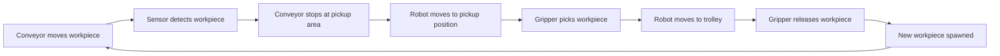

# 🤖 Automated Assembly Line using ROS 2 and Gazebo


A simulated industrial assembly line built with **ROS 2 Humble** and **Gazebo Classic**. Workpieces travel along a conveyor, are detected by a sensor, picked up by a robotic arm, and placed into a collection trolley. The cycle then repeats automatically with a new workpiece.

> **Highlights:** conveyor control · sensor-based detection · robotic pick-and-place · trolley collection · continuous workpiece spawning

---

## 📑 Table of Contents

- [Demo](#-demo)
- [Key Features](#-key-features)
- [System Workflow](#-system-workflow)
- [Architecture](#-architecture)
- [Technologies Used](#-technologies-used)
- [Prerequisites](#-prerequisites)
- [Installation](#-installation)
- [Usage](#-usage)
- [Project Structure](#-project-structure)
- [Troubleshooting](#-troubleshooting)
- [Future Improvements](#-future-improvements)
- [Contributing](#-contributing)
- [Author](#-author)

---

## 📸 Demo

| Complete Assembly Line | Startup State |
|:---:|:---:|
|  |  |

| Workpiece Arriving on Conveyor | Robot Picking Workpiece |
|:---:|:---:|
|  |  |

| Placing Workpiece in Trolley | Pick-and-Place Completed |
|:---:|:---:|
|  |  |

| Repeated Handling (Second Workpiece) |
|:---:|
|  |

---

## ✨ Key Features

- **Conveyor transport:** workpieces move along a simulated conveyor in Gazebo.
- **Sensor-based detection:** a sensor detects workpieces approaching the pickup area.
- **Automatic stop:** the conveyor halts while the pick operation is in progress.
- **Industrial robotic arm:** simulated arm with trajectory-controlled motion.
- **Gripper control:** reliable pickup and release of workpieces.
- **Trolley collection:** workpieces are placed into a collection trolley.
- **Continuous operation:** new workpieces are spawned so the cycle repeats.
- **Modular ROS 2 nodes:** conveyor, detection, and robot logic are coordinated through topics and actions.

---

## 🏗️ System Workflow



1. The conveyor transports a workpiece toward the detection area.
2. The sensor detects the approaching workpiece.
3. The conveyor stops when the workpiece reaches the pickup area.
4. The robot moves to the pickup position.
5. The gripper picks up the workpiece.
6. The robot carries the workpiece to the trolley.
7. The gripper releases the workpiece into the trolley.
8. The system introduces another workpiece and the cycle repeats.

---

## 🧩 Architecture

The system is split into small, cooperating components:

| Component | Responsibility |
|-----------|----------------|
| Conveyor controller | Starts and stops conveyor movement |
| Detection node | Publishes sensor events when a workpiece is in the pickup area |
| Robot controller | Plans and executes pick-and-place motions via trajectory actions |
| Gripper controller | Opens and closes the gripper |
| Workpiece manager | Spawns and removes workpieces in Gazebo |

<!-- TODO: Replace the names above with your actual node names and add the key topics/actions, e.g. /conveyor/cmd, /sensor/detected -->

---

## 🛠️ Technologies Used

| Category | Technology |
|----------|------------|
| Operating System | Ubuntu 22.04 |
| Middleware | ROS 2 Humble |
| Simulation | Gazebo Classic 11 |
| Language | Python |
| Robot Description | URDF / Xacro |
| Control | ROS 2 controllers and trajectory actions |
| Communication | ROS 2 topics and actions |

---

## 📋 Prerequisites

- Ubuntu 22.04
- [ROS 2 Humble](https://docs.ros.org/en/humble/Installation.html)
- Gazebo Classic 11 with ROS integration
- `colcon` and `rosdep`

Install the common dependencies:

```bash
sudo apt update
sudo apt install -y \
  ros-humble-gazebo-ros-pkgs \
  ros-humble-ros2-control \
  ros-humble-ros2-controllers \
  ros-humble-joint-trajectory-controller \
  ros-humble-xacro \
  python3-colcon-common-extensions \
  python3-rosdep
```

<!-- TODO: Add any extra packages your project needs. -->

---

## 🚀 Installation

### 1. Clone the repository

```bash
mkdir -p ~/assembly_line_ws/src
cd ~/assembly_line_ws/src
git clone https://github.com/prachikale05/ros2-gazebo-assembly-line.git assembly_line
```

### 2. Install dependencies

```bash
cd ~/assembly_line_ws
rosdep install --from-paths src --ignore-src -r -y
```

### 3. Build the workspace

```bash
colcon build --symlink-install
```

### 4. Source the workspace

```bash
source /opt/ros/humble/setup.bash
source ~/assembly_line_ws/install/setup.bash
```

---

## ▶️ Usage

Launch the simulation:

```bash
ros2 launch <your_package_name> <your_launch_file>.launch.py
```

<!-- TODO: Replace the placeholders above with your real package and launch file names. -->

Once launched, you should see the conveyor start, the first workpiece approach the sensor, and the robot perform the pick-and-place cycle automatically.

---

## 📁 Project Structure

```text
assembly_line/
├── images/          # Screenshots used in this README
├── launch/          # Launch files
├── urdf/            # Robot, conveyor, and trolley descriptions
├── worlds/          # Gazebo world files
├── config/          # Controller configuration
├── scripts/         # ROS 2 Python nodes
└── README.md
```

<!-- TODO: Adjust this tree to match your actual folders. -->

---

## 🩹 Troubleshooting

| Problem | Possible fix |
|---------|--------------|
| Gazebo opens with a black screen or crashes | Kill stale processes: `killall gzserver gzclient`, then relaunch |
| Package not found | Re-source the workspace: `source install/setup.bash` |
| Controllers fail to load | Confirm `ros2_control` and controller packages are installed, then check the controller config file |
| Robot does not move | Check that controllers are active: `ros2 control list_controllers` |

---

## 🔮 Future Improvements

- Add camera-based object detection (e.g. with OpenCV).
- Support multiple workpiece types with sorting.
- Integrate MoveIt 2 for advanced motion planning.
- Add a status dashboard or RViz visualization.
- Migrate to Gazebo Sim (Ignition) for newer ROS 2 distributions.

---

## 🤝 Contributing

Contributions, issues, and feature requests are welcome. Feel free to open an issue or submit a pull request.

---

## 👩‍💻 Author

**Prachi Kale**
GitHub: [@prachikale05](https://github.com/prachikale05)

<!-- TODO: Add a LICENSE file and mention it here, e.g. "This project is licensed under the MIT License." -->
