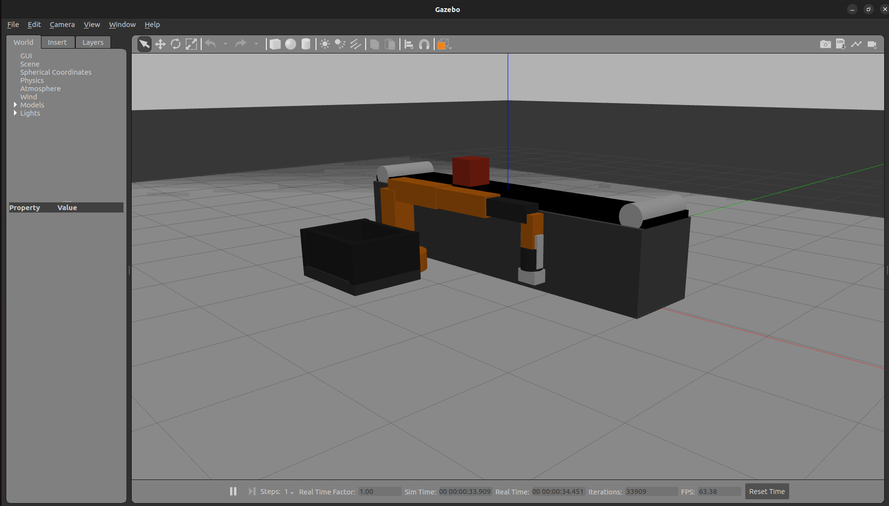
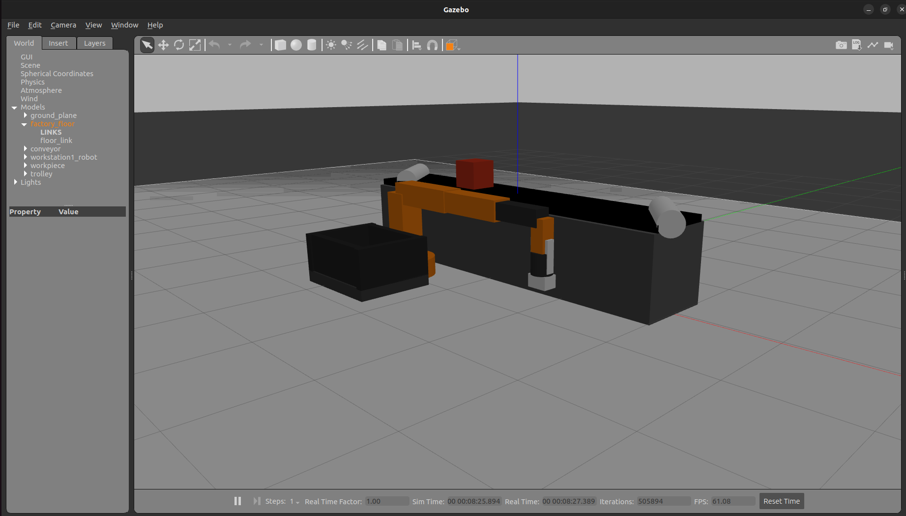
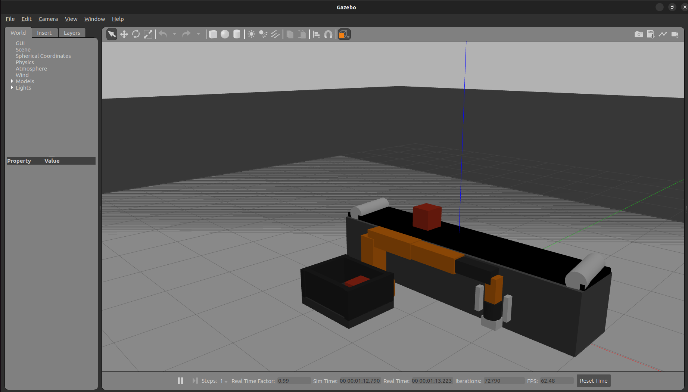
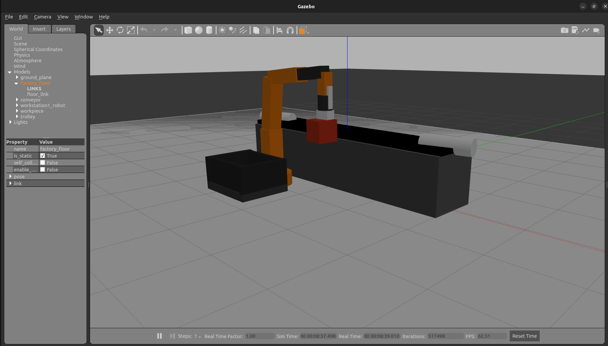
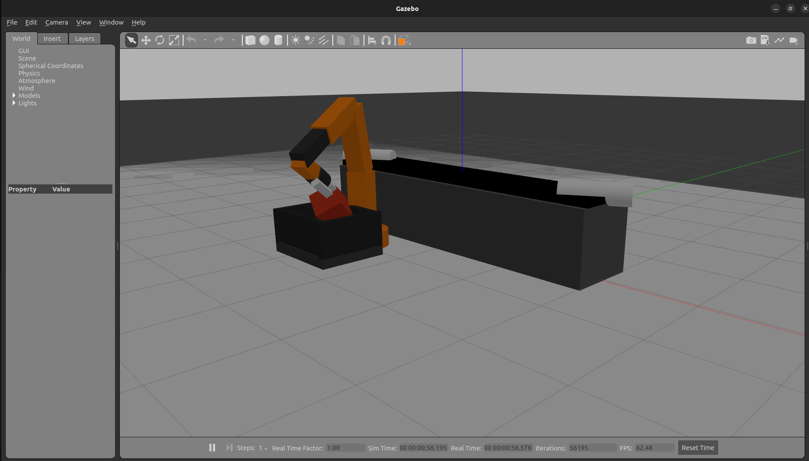
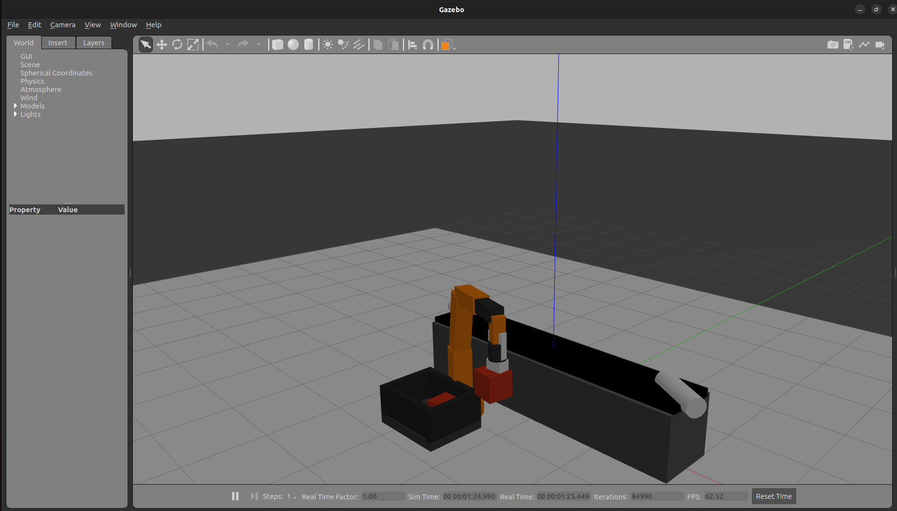

# 🤖 Automated Assembly Line Using ROS 2 and Gazebo

A simulated automated assembly line developed using **ROS 2 Humble and Gazebo Classic**. The system demonstrates conveyor-based workpiece transportation, sensor-based detection, robotic pick-and-place operations, and repeated workpiece handling.

The project integrates robot control, conveyor movement, workpiece management, and trolley-based collection in a simulated industrial environment.

## 📸 Project Demonstration

### 1. Complete Assembly Line



### 2. Assembly Line at Startup



### 3. Conveyor and Workpiece Movement



### 4. Robotic Pick Operation



### 5. Workpiece Placement in Trolley



### 6. Completed Pick-and-Place Operation


### 7. Repeated Workpiece Handling



## ✨ Key Features

- Conveyor-based workpiece transportation in Gazebo.
- Sensor-based workpiece detection.
- Automatic conveyor stopping during the pick operation.
- Industrial robotic arm simulation.
- Gripper-controlled workpiece pickup and release.
- Automated workpiece placement into a collection trolley.
- Repeated workpiece spawning and handling.
- ROS 2 nodes for coordinating conveyor movement, detection, and robot actions.

## 🛠️ Technologies Used

- **Operating System:** Ubuntu 22.04
- **Robotics Middleware:** ROS 2 Humble
- **Simulation:** Gazebo Classic 11
- **Programming:** Python
- **Robot Description:** URDF/Xacro
- **Robot Control:** ROS 2 controllers and trajectory actions
- **Communication:** ROS 2 topics and actions

## 🏗️ System Workflow

1. The conveyor transports a workpiece toward the detection area.
2. The sensor detects the approaching workpiece.
3. The conveyor stops when the workpiece reaches the pickup area.
4. The robot moves to the pickup position.
5. The gripper picks up the workpiece.
6. The robot transports the workpiece to the trolley.
7. The gripper releases the workpiece into the trolley.
8. The system introduces another workpiece and repeats the cycle.

## 📋 Prerequisites

Before running the project, install and configure:

- Ubuntu 22.04
- ROS 2 Humble
- Gazebo Classic 11
- Required ROS 2 packages and controllers used by this project

## 🚀 Installation and Execution

### 1. Clone the Repository

```bash
mkdir -p ~/assembly_line_ws/src
cd ~/assembly_line_ws/src
git clone https://github.com/prachikale05/ros2-gazebo-assembly-line.git assembly_line
