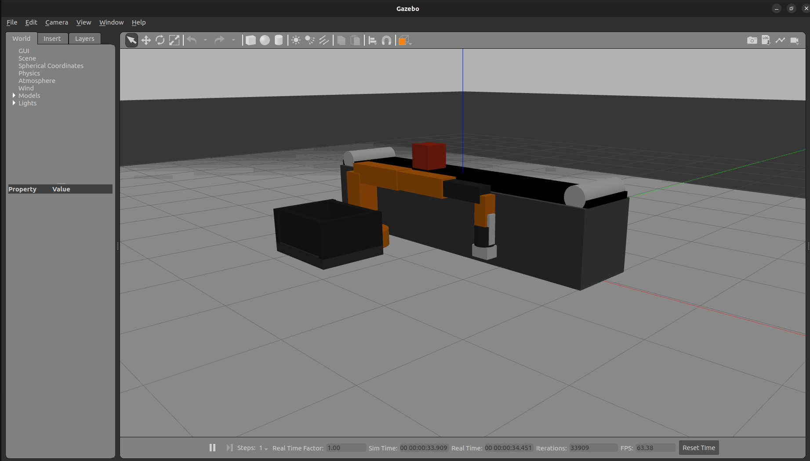
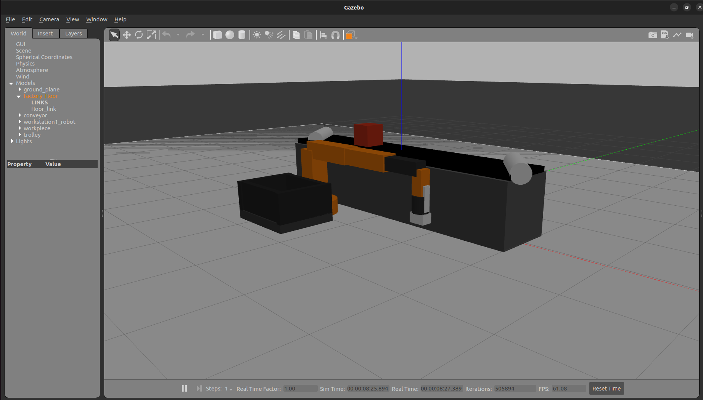
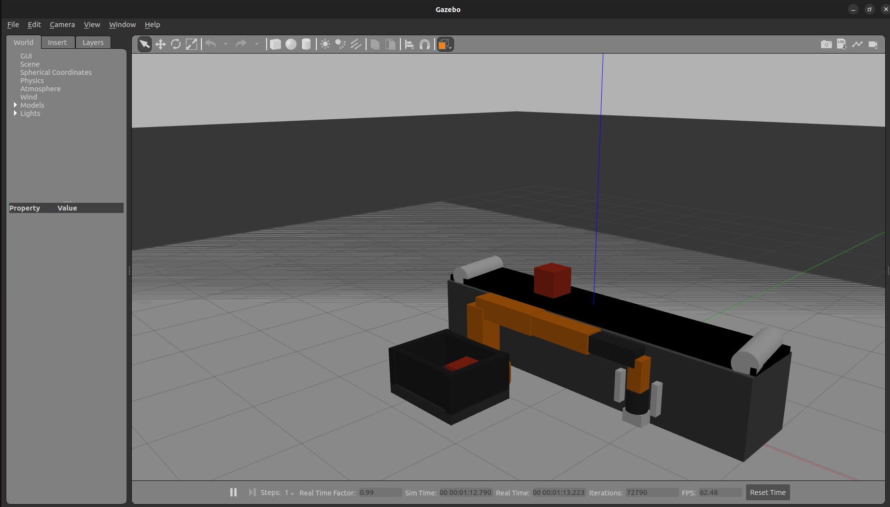
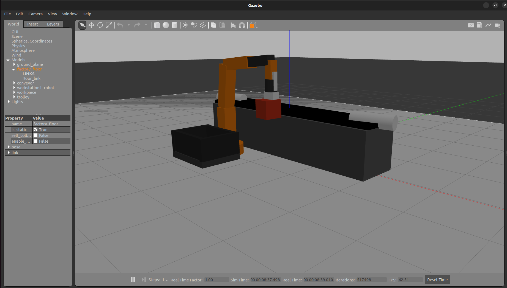
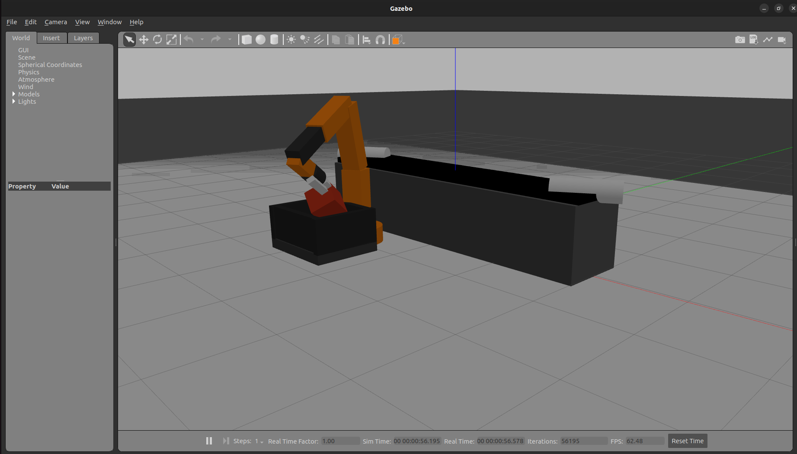
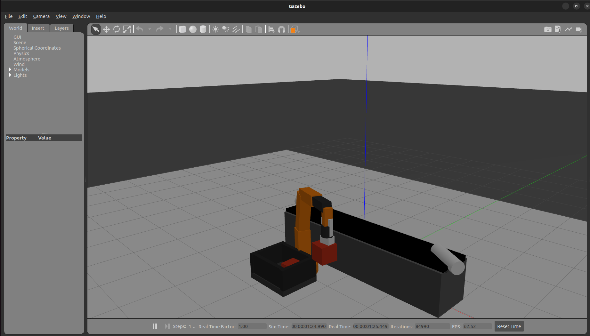
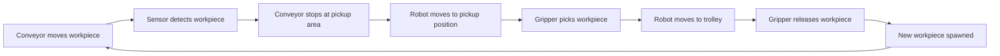

# 🤖 Automated Assembly Line using ROS 2 and Gazebo


A simulated industrial assembly line built with **ROS 2 Humble** and **Gazebo Classic**. Workpieces travel along a conveyor, are detected by a sensor, picked up by a robotic arm, and placed into a collection trolley. The cycle then repeats automatically with a new workpiece.

> **Highlights:** conveyor control · sensor-based detection · robotic pick-and-place · trolley collection · continuous workpiece spawning

---

## 📑 Table of Contents

- [Demo](#-demo)
- [Key Features](#-key-features)
- [System Workflow](#️-system-workflow)
- [Architecture](#-architecture)
- [Technologies Used](#️-technologies-used)
- [Prerequisites](#-prerequisites)
- [Installation](#-installation)
- [Usage](#️-usage)
- [Project Structure](#-project-structure)
- [Troubleshooting](#-troubleshooting)
- [Future Improvements](#-future-improvements)
- [License](#-license)
- [Contributing](#-contributing)
- [Author](#-author)

---

## 📸 Demo

| Complete Assembly Line | Startup State |
|:---:|:---:|
|  |  |

| Workpiece Arriving on Conveyor | Robot Picking Workpiece |
|:---:|:---:|
|  |  |

| Placing Workpiece in Trolley | Pick-and-Place Completed |
|:---:|:---:|
|  |  |

| Repeated Handling (Second Workpiece) |
|:---:|
|  |

---

## ✨ Key Features

- **Conveyor transport:** workpieces move along a simulated conveyor in Gazebo.
- **Sensor-based detection:** a sensor detects workpieces approaching the pickup area.
- **Automatic stop:** the conveyor halts while the pick operation is in progress.
- **Industrial robotic arm:** simulated arm with trajectory-controlled motion.
- **Gripper control:** reliable pickup and release of workpieces.
- **Trolley collection:** workpieces are placed into a collection trolley.
- **Continuous operation:** new workpieces are spawned so the cycle repeats.
- **Modular ROS 2 nodes:** conveyor, detection, and robot logic are coordinated through topics and actions.

---

## 🏗️ System Workflow



1. The conveyor transports a workpiece toward the detection area.
2. The sensor detects the approaching workpiece.
3. The conveyor stops when the workpiece reaches the pickup area.
4. The robot moves to the pickup position.
5. The gripper picks up the workpiece.
6. The robot carries the workpiece to the trolley.
7. The gripper releases the workpiece into the trolley.
8. The system introduces another workpiece and the cycle repeats.

---

## 🧩 Architecture

The project is a single ROS 2 Python package named **`assembly_line`**. It provides three executable nodes that cooperate through ROS 2 topics and actions, plus Gazebo models, a robot description, and launch files.

| Node (executable) | Role |
|-------------------|------|
| `workpiece_controller` | Manages the workpiece and conveyor behavior |
| `workpiece_sensor` | Detects when a workpiece reaches the pickup area |
| `automatic_pick_place` | Runs the automatic pick-and-place sequence with the robot arm |

Supporting pieces:

| Part | Description |
|------|-------------|
| `models/conveyor`, `models/workpiece`, `models/trolley` | Gazebo models for the conveyor, workpiece, and collection trolley |
| `description/` | Xacro robot description (robot files in `description/robot/`) |
| `worlds/` | Gazebo world files |
| `config/` | Controller configuration |
| `plugins/` | Custom Gazebo plugin sources |
| `attach_workpiece.py` | Helper script for attaching the workpiece during pickup |

---

## 🛠️ Technologies Used

| Category | Technology |
|----------|------------|
| Operating System | Ubuntu 22.04 |
| Middleware | ROS 2 Humble |
| Simulation | Gazebo Classic 11 |
| Language | Python (`rclpy`) |
| Robot Description | URDF / Xacro |
| Control | ROS 2 controllers and trajectory actions |
| Communication | ROS 2 topics and actions |
| Message packages | `std_msgs`, `geometry_msgs`, `sensor_msgs` |

---

## 📋 Prerequisites

- Ubuntu 22.04
- [ROS 2 Humble](https://docs.ros.org/en/humble/Installation.html)
- Gazebo Classic 11 with ROS integration
- `colcon` and `rosdep`

Install the common dependencies:

```bash
sudo apt update
sudo apt install -y \
  ros-humble-gazebo-ros-pkgs \
  ros-humble-ros2-control \
  ros-humble-ros2-controllers \
  ros-humble-joint-trajectory-controller \
  ros-humble-xacro \
  python3-colcon-common-extensions \
  python3-rosdep
```

The package itself depends on `rclpy`, `std_msgs`, `geometry_msgs`, `sensor_msgs`, and `ament_index_python`, which `rosdep` installs for you in the next section.

---

## 🚀 Installation

### 1. Clone the repository

```bash
mkdir -p ~/assembly_line_ws/src
cd ~/assembly_line_ws/src
git clone https://github.com/prachikale05/ros2-gazebo-assembly-line.git assembly_line
```

### 2. Install dependencies

```bash
cd ~/assembly_line_ws
source /opt/ros/humble/setup.bash
rosdep install --from-paths src --ignore-src -r -y
```

### 3. Build the workspace

```bash
colcon build --symlink-install --packages-select assembly_line
```

### 4. Source the workspace

```bash
source ~/assembly_line_ws/install/setup.bash
```

---

## ▶️ Usage

Launch the simulation using one of the launch files in the `launch/` folder:

```bash
ros2 launch assembly_line <launch_file_name>.launch.py
```

To see the available launch files:

```bash
ls ~/assembly_line_ws/src/assembly_line/launch
```

Once launched, the conveyor starts, the first workpiece approaches the sensor, and the robot performs the pick-and-place cycle automatically.

You can also run the individual nodes in separate terminals (after sourcing the workspace):

```bash
ros2 run assembly_line workpiece_controller
ros2 run assembly_line workpiece_sensor
ros2 run assembly_line automatic_pick_place
```

Useful commands for inspecting the running system:

```bash
ros2 node list
ros2 topic list
ros2 control list_controllers
```

---

## 📁 Project Structure

```text
assembly_line/
├── assembly_line/          # Python package with the ROS 2 nodes
├── config/                 # Controller configuration
├── description/            # Xacro robot description (robot/ subfolder)
├── images/                 # Screenshots used in this README
├── launch/                 # Launch files
├── models/                 # Gazebo models (conveyor, workpiece, trolley)
├── plugins/                # Custom Gazebo plugins
├── resource/               # ament resource index marker
├── scripts/                # Helper scripts
├── test/                   # Linting and unit tests
├── worlds/                 # Gazebo world files
├── attach_workpiece.py     # Workpiece attach helper
├── CMakeLists.txt
├── package.xml
├── setup.cfg
├── setup.py
└── README.md
```

---

## 🩹 Troubleshooting

| Problem | Possible fix |
|---------|--------------|
| Gazebo opens with a black screen or crashes | Kill stale processes: `killall gzserver gzclient`, then relaunch |
| `Package 'assembly_line' not found` | Re-source the workspace: `source ~/assembly_line_ws/install/setup.bash` |
| Models do not appear in Gazebo | Rebuild with `colcon build --symlink-install` and confirm the `models/` folder was installed |
| Controllers fail to load | Confirm `ros2_control` and controller packages are installed, then check the files in `config/` |
| Robot does not move | Check that controllers are active: `ros2 control list_controllers` |

---

## 🔮 Future Improvements

- Add camera-based object detection (e.g. with OpenCV).
- Support multiple workpiece types with sorting.
- Integrate MoveIt 2 for advanced motion planning.
- Add a status dashboard or RViz visualization.
- Migrate to Gazebo Sim (Ignition) for newer ROS 2 distributions.

---

## 📄 License

This project is licensed under the **Apache License 2.0**.

---

## 🤝 Contributing

Contributions, issues, and feature requests are welcome. Feel free to open an issue or submit a pull request.

---

## 👩‍💻 Author

**Prachi Kale**
GitHub: [@prachikale05](https://github.com/prachikale05)
